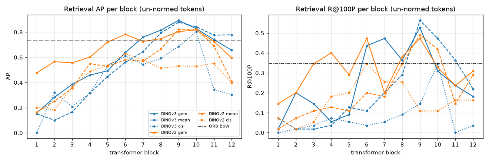
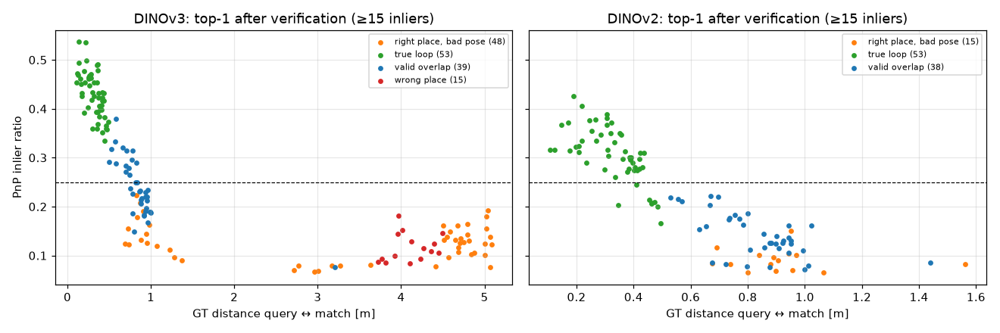
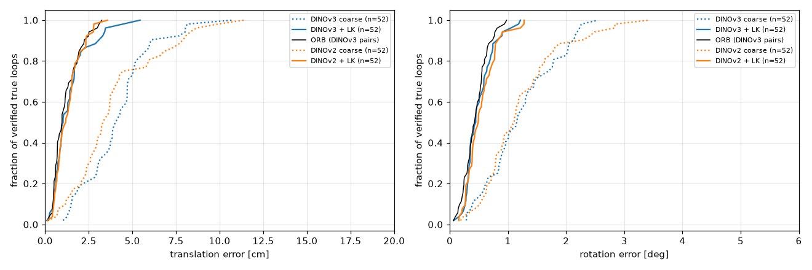

# Loop closure: DINOv2 vs DINOv3

*Sequence `fr3_long_office_household`, ViT-S backbones, CPU only. Run on 2026-11-17. Companion to [LOOP_CLOSURE_REPORT.md](LOOP_CLOSURE_REPORT.md), which describes the protocol and the DINOv3 results in detail.*

## TL;DR

The loop-closure study was re-run with **DINOv2 ViT-S/14 with 4 registers** (LVD-142M) in place of DINOv3 ViT-S/16 (LVD-1689M). Everything else was the same: protocol, thresholds, matchers and ORB baseline.

| | DINOv3 | DINOv2 | ORB |
|---|---|---|---|
| Retrieval only, final layer, AP / R@1 | **0.750 / 0.873** (mean) | 0.591 / 0.764 (GeM) | 0.731 / 0.836 |
| Retrieval only, best block, AP / R@100P | **0.894 / 0.527** (block 9, GeM) | 0.824 / 0.418 (block 10, mean) | |
| Block-9 GeM + top-5 patch verification, AP / R@100P | **0.957** / 0.764 | 0.938 / **0.855** | 0.828 / 0.400 |
| Loop pose with LK refinement, median / p90 translation | **1.03** / 3.07 cm | 1.19 / **2.34** cm | 0.97 / 2.25 cm |
| Min #inliers with no harmful loop (follow-up) | 117 | **78** | 77 |
| Wrong-place top-1s with ≥ 15 inliers | 15 | **0** | |
| True loops kept with **zero** bad constraints (final pipeline) | **53 / 55** (ratio ≥ 0.25) | 51 / 55 (ratio ≥ 0.20); 53 / 55 with ≥ 75 inliers | 51 / 55 |
| Extraction, all blocks, 640×480, CPU | **0.96 s/frame** | 1.18 s/frame | |

1. **DINOv3 is the better place recogniser.** At its final layer DINOv2 is *worse than ORB BoW*: mean pooling collapses to AP 0.43. At the best block the gap shrinks to about 0.07 AP, but DINOv3 leads at every block from 7 to 12.
2. **DINOv2's local patch matches are more discriminative.** Looking-alike places that are far apart (the "other side of the desks" aliasing) yield up to 44 PnP inliers with DINOv3, and never more than 14 with DINOv2. DINOv2 therefore never accepts a wrong place and needs a much lower inlier threshold to be safe.
3. **After verification the two are close.** DINOv3 has the higher AP (0.957 vs 0.938). DINOv2 has the higher R@100P (0.855 vs 0.764), i.e. more loops can be accepted on the score before the first false one.
4. **Pose accuracy is a tie.** With LK refinement both are within ~0.2 cm / 0.05° of ORB.
5. **The DINOv3 acceptance rule does not transfer.** DINOv2's inlier ratios are lower overall (median on true loops 0.31 vs 0.43). An inlier-ratio threshold of 0.25 keeps only 45 / 55 true loops with DINOv2, so DINOv2 needs its own threshold (≈ 0.20, or ≥ 75 inliers).

**Bottom line:** DINOv3 remains the recommendation for this pipeline, mainly because of retrieval quality and the simpler acceptance rule. DINOv2 is a credible alternative, and it has the edge on rejecting perceptual aliasing.

---

## 1. Setup and what differs

Both models are run through the same scripts. `LC_BACKBONE` selects the model, and each writes to its own results folder.

| | DINOv3 | DINOv2 |
|---|---|---|
| Checkpoint | `timm/vit_small_patch16_dinov3.lvd1689m` | `timm/vit_small_patch14_reg4_dinov2.lvd142m` |
| Training data | LVD-1689M | LVD-142M |
| Blocks / width / registers | 12 / 384 / 4 | 12 / 384 / 4 |
| Patch size → grid at 640×480 | 16 px → 40×30 = 1200 patches | 14 px → 46×34 = 1564 patches |
| Results | `results/loop_closure/` | `results/loop_closure_dinov2/` |

DINOv2 was chosen **with registers** so that the two backbones share size and architecture, which leaves mostly the training recipe and data as the difference. The one structural difference left is the patch size. DINOv2 at native resolution has a 30 % finer grid. This matters for two things:
- **Raw inlier counts are not directly comparable**, so the comparisons below lean on inlier ratio and pose error.
- **Coarse (unrefined) poses favour DINOv2 slightly**, because its patch centres are 14 px apart instead of 16 px.

The block-9 retrieval layer was originally chosen for DINOv3 from {6, 9, 12}. To make sure this choice did not handicap DINOv2, `loop_closure_layer_sweep.py` scores every block for both models (§2.2).

## 2. Retrieval (appearance only)

### 2.1 Final layer

| Descriptor | DINOv3 AP / R@1 / R@100P | DINOv2 AP / R@1 / R@100P |
|---|---|---|
| CLS | 0.335 / 0.491 / 0.036 | 0.414 / 0.545 / 0.200 |
| mean | **0.750 / 0.873** / 0.218 | 0.427 / 0.545 / 0.291 |
| GeM | 0.733 / 0.855 / 0.255 | 0.591 / 0.764 / 0.255 |
| CLS+mean | 0.400 / 0.527 / 0.109 | 0.550 / 0.691 / 0.236 |
| VLAD (32 words) | 0.684 / 0.800 / 0.200 | 0.574 / 0.654 / **0.327** |
| ORB BoW | 0.731 / 0.836 / 0.345 | (same) |

DINOv2's final-layer patch tokens are a poor place descriptor here, and every pooled variant falls below ORB BoW. Its CLS token is slightly better than DINOv3's, but both are unusable. Halving the input resolution helped DINOv3's final layer a lot (GeM 0.73 → 0.83) but made DINOv2's slightly worse (GeM 0.59 → 0.55; see `results/loop_closure_compare/layer_x_scale_ablation_ap.csv`).

### 2.2 Every block



| Block | DINOv3 GeM | DINOv3 mean | DINOv2 GeM | DINOv2 mean |
|---|---|---|---|---|
| 1 | 0.158 | 0.152 | **0.476** | 0.164 |
| 4 | 0.459 | 0.316 | **0.602** | 0.550 |
| 6 | 0.639 | 0.560 | **0.783** | 0.581 |
| 8 | **0.815** | 0.794 | 0.748 | 0.666 |
| 9 | **0.894** | 0.879 | 0.805 | 0.821 |
| 10 | 0.827 | **0.843** | 0.817 | 0.824 |
| 11 | 0.741 | **0.776** | 0.725 | 0.690 |
| 12 | 0.656 | **0.779** | 0.595 | 0.409 |

(AP; full table with CLS and R@100P in `results/loop_closure_compare/all_block_sweep_*.csv`.)

* **Both models peak at blocks 9–10**, so block 9 is a fair choice for DINOv2. DINOv2's best (block 10, mean, 0.824) is only 0.003 above its block 9.
* **DINOv2 is much stronger in the early blocks.** Its GeM beats DINOv3's at every block up to 6, and at block 6 it already passes ORB. DINOv3 builds up its place-recognition ability later and reaches a higher peak.
* **DINOv2 drops off more sharply at the end** (mean 0.82 → 0.41 from block 10 to 12). If DINOv2 is used, the readout layer matters even more than with DINOv3.
* DINOv3's CLS token has a narrow peak at block 10 (0.80), which then collapses in the final blocks.

## 3. Geometric verification

The top-5 candidates are re-ranked by the number of PnP inliers. In the "patch verif." rows, each model verifies with its own patch tokens.

| Pipeline | DINOv3 R@1 / AP / R@100P | DINOv2 R@1 / AP / R@100P |
|---|---|---|
| block-9 GeM + patch verif. | **0.964 / 0.957** / 0.764 | 0.946 / 0.938 / **0.855** |
| block-9 GeM + ORB verif. | 0.982 / 0.937 / 0.345 | 0.964 / 0.907 / 0.345 |
| final-layer mean + patch verif. | 0.946 / 0.934 / 0.673 | 0.873 / 0.836 / 0.491 |
| ORB BoW + ORB verif. | 0.927 / 0.828 / 0.400 | (same) |

Verification closes most of DINOv2's retrieval gap: with top-5 candidates R@5 is 1.0 for both, so the verifier sees the right place either way. DINOv2 then gives the best R@100P of any pipeline tested. Its verified scores separate true from false loops more cleanly, even though its AP is slightly lower.

### Why: perceptual aliasing



The sequence circles two desks, and the far side looks a lot like the near side. Of the 382 queries with candidates, ~260 have a top-1 more than 2 m away, which is necessarily a wrong place:

| Top-1 more than 2 m from the query | DINOv3 | DINOv2 |
|---|---|---|
| with ≥ 15 PnP inliers | 49 | **0** |
| max #inliers | 44 | **14** |
| max inlier ratio | 0.193 | **0.057** |

DINOv3's patch tokens find dozens of geometrically consistent matches between the two sides of the desks. DINOv2's do not. In the plot above, the whole cluster of DINOv3 "wrong place" and "right place, bad pose" cases at 3–5 m is absent for DINOv2. The flip side is that DINOv2 also produces **fewer inliers on true loops** (median ratio 0.31 vs 0.43, median count 177 vs 232), so true and false loops are both shifted down.

It is an open question whether this comes from the training (DINOv2's tokens being more instance-specific) or from the finer grid (14 px patches carrying more local detail). A DINOv2 run at a 0.875 input scale, which gives the same 40×30 grid as DINOv3, would separate the two and was not run.

## 4. Loop-constraint accuracy

These are the relative-pose errors of the 52 verified true loops against mocap. Each model's pairs are its own verified set; the GT baselines are similar (median 0.35 m / 13.6° for DINOv3, 0.34 m / 11.3° for DINOv2).

| Matches used for PnP | DINOv3 median / p90 trans., median rot. | DINOv2 median / p90 trans., median rot. |
|---|---|---|
| coarse patch centres | 4.09 / 6.09 cm, 1.16° | **3.37** / 7.89 cm, **1.11°** |
| soft-argmax | 5.36 / 9.86 cm, 1.74° | **4.58 / 9.07 cm, 1.42°** |
| patch + LK | **1.03** / 3.07 cm, **0.45°** | 1.19 / **2.34** cm, 0.49° |
| ORB (same pairs) | 0.97 / 2.25 cm, 0.43° | 1.05 / 2.20 cm, 0.44° |

The coarse and soft-argmax advantage for DINOv2 is what the 14-px grid would predict. After LK refinement both are at ORB level: DINOv2 has a slightly higher median and a tighter tail (100 % vs 98 % within 5 cm & 5°). This is a tie.



## 5. Accepting loops: which constraints reach the graph

These results use the same four classes as §3.7 of the main report:
* **true loop**: within 0.5 m / 30° of the query, with a correct pose
* **valid overlap**: outside that radius, but the estimated pose is within 10 cm / 5° of ground truth
* **right place, bad pose**: the frames overlap, but the pose error is above 10 cm or 5°
* **wrong place**: no visual overlap

Every model uses the recommended pipeline: block-9 GeM retrieval → patch verification → pose from LK-refined matches.

| Accept if | DINOv3 true / valid / bad pose / wrong | DINOv2 true / valid / bad pose / wrong |
|---|---|---|
| ratio ≥ 0.10 | 53 / 38 / 36 / 9 | 53 / 31 / 5 / **0** |
| ratio ≥ 0.15 | 53 / 37 / 12 / 2 | 53 / 16 / 1 / 0 |
| ratio ≥ 0.20 | 53 / 28 / 2 / 0 | 51 / 6 / **0 / 0** |
| ratio ≥ 0.25 | 53 / 16 / **0 / 0** | 45 / 0 / 0 / 0 |
| ratio ≥ 0.30 | 53 / 6 / 0 / 0 | 31 / 0 / 0 / 0 |
| #inliers ≥ 30 | 53 / 38 / 12 / 0 | 53 / 32 / 6 / 0 |
| #inliers ≥ 50 | 53 / 35 / 3 / 0 | 53 / 26 / 1 / 0 |
| #inliers ≥ 75 | 53 / 23 / **0 / 0** | 53 / 14 / **0 / 0** |

* **At loose thresholds DINOv2 is much safer**: 5 bad constraints at ratio ≥ 0.10, against 45 for DINOv3.
* **At the loosest safe threshold DINOv3 keeps more.** With ratio ≥ 0.25 it keeps 53 true loops plus 16 extra valid overlaps. DINOv2's best safe ratio threshold (0.20) keeps 51 + 6. On inlier count both are safe from 75 inliers up and keep 53 true loops there; DINOv3 keeps 23 extra overlaps against DINOv2's 14.
* **The ratio margin is thin for both.** DINOv3: worst bad case 0.224, threshold 0.25. DINOv2: worst bad case 0.151, but its lowest true loop is at 0.166. So for DINOv2 an inlier-**count** rule (≥ 75) is the more robust choice. Its 0.25 ratio rule loses 8 true loops.

In the follow-up analysis, where the pose comes from the verifier itself rather than from LK, DINOv2 is safe from 78 inliers and DINOv3 only from 117. Both keep 53 true loops there.

## 6. Compute

| | DINOv3 | DINOv2 |
|---|---|---|
| One pass, all 12 blocks, 640×480, 8 CPU threads | 0.96 s/frame | 1.18 s/frame |
| Same, at ×0.5 input | 0.19 s/frame | 0.21 s/frame |

DINOv2 is ~20 % slower at native resolution because it processes 30 % more tokens. The weights are the same size.

## 7. Recommendations

1. **Keep DINOv3 as the default backbone** for loop closure. It retrieves better at every useful layer, and its higher inlier ratios on true loops make the ratio threshold easy to set.
2. **If DINOv2 is used** (e.g. for licensing reasons, or because it is already in the stack):
   * read out block 9 or 10 (mean or GeM), **never the final layer**;
   * accept loops on **#inliers ≥ 75** rather than on inlier ratio, or re-tune the ratio threshold (≈ 0.20);
   * expect fewer aliasing false positives and no difference in pose accuracy after LK.
3. **Worth trying:** retrieve with DINOv3 block-9 GeM and verify with DINOv2 patches. This combines the better retrieval with the cleaner verification, at the cost of two forward passes per keyframe.

## Limitations

* **One sequence, 55 loop queries.** The same caveats apply as in the main report: thresholds are picked on the evaluation data, and differences of 1–2 loops are noise.
* **The grids differ** (14 px vs 16 px patches). A grid-matched DINOv2 run (input ×0.875) was not done, so §3's aliasing finding cannot yet be attributed to training rather than resolution.
* **Only ViT-S was tested**, DINOv2 only with registers. `LC_BACKBONE=dinov2_noreg` runs the register-free DINOv2 but was not run.
* **Small fp16 caching effect.** The layer sweep pools descriptors in fp32 without the fp16 patch cache, so its numbers can differ from the main ablation in the third decimal (e.g. DINOv2 block-6 GeM 0.782 vs 0.783).
* **No pose-graph optimisation was run.** As in the main report, the effect on trajectory error is inferred, not measured.

## Reproduce

```bash
export HF_HUB_DISABLE_IMPLICIT_TOKEN=1   # the stored HF token is invalid and blocks even public timm downloads
LC_BACKBONE=dinov2 .venv/bin/python loop_closure_experiments.py     # ~25 min CPU → results/loop_closure_dinov2/
LC_BACKBONE=dinov2 .venv/bin/python loop_closure_followup.py        # ~15 min
LC_BACKBONE=dinov2 .venv/bin/python loop_closure_final_pipeline.py  # ~3 min
.venv/bin/python loop_closure_layer_sweep.py dinov3 dinov2          # ~20 min, all 12 blocks, both models
.venv/bin/python loop_closure_compare.py                            # tables + cmp*.png → results/loop_closure_compare/
```

Without `LC_BACKBONE` (or with `LC_BACKBONE=dinov3`) the scripts reproduce the original DINOv3 results unchanged. `LC_RET_LAYER` changes the retrieval block used by the follow-up and final-pipeline scripts (default 9). All comparison tables are also written as CSV and as one Markdown file, `results/loop_closure_compare/tables.md`.
