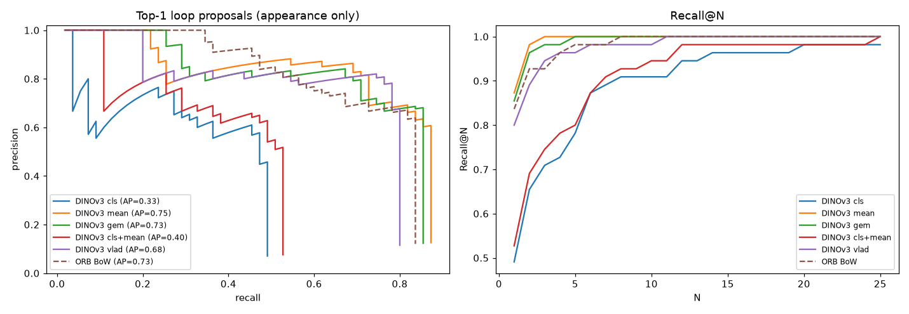
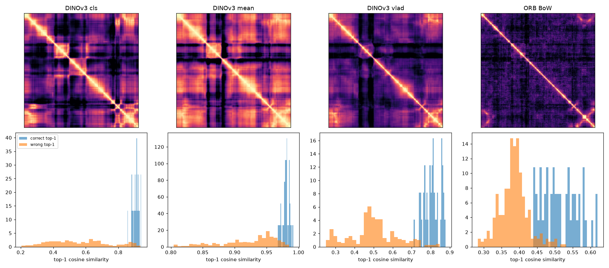
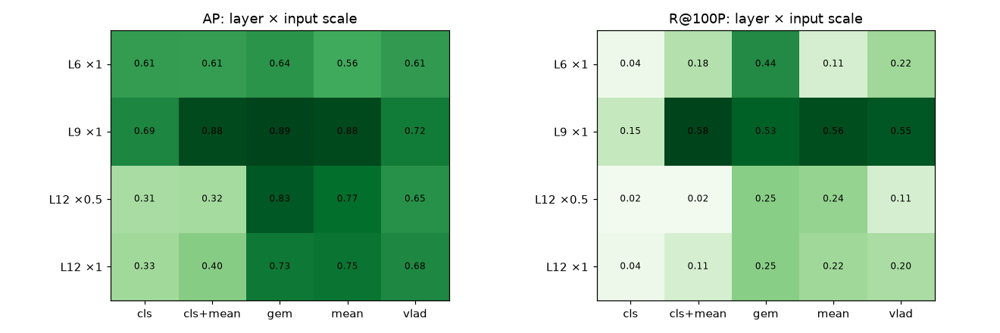
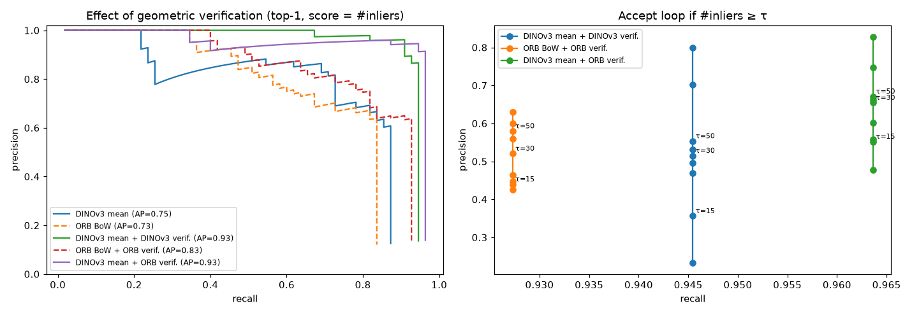
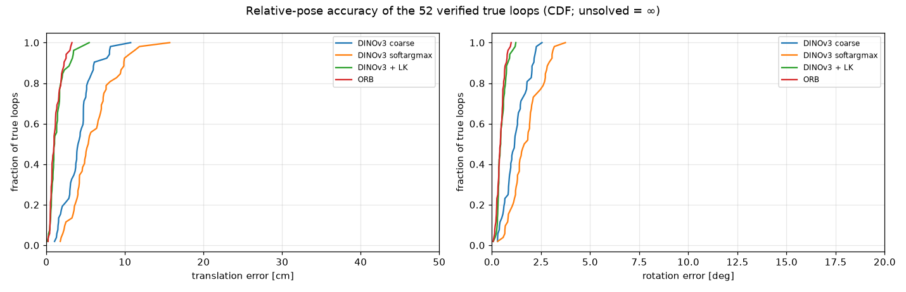
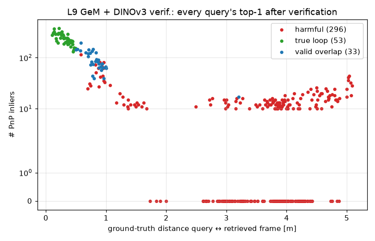
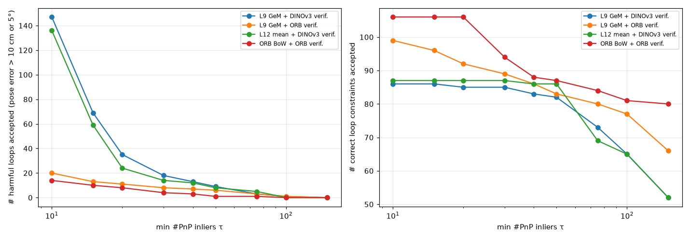

# Loop closure with DINOv3 on TUM RGB-D: what was done and what came out

*Sequence `fr3_long_office_household`, DINOv3 ViT-S/16, CPU only. Run on 2026-11-14.*

## TL;DR

| | Best ORB pipeline | Best DINOv3 pipeline |
|---|---|---|
| Appearance-only retrieval, AP / R@1 | 0.731 / 0.836 (ORB BoW) | **0.894 / 0.945** (GeM of **block-9** patch tokens) |
| After geometric verification, AP / R@100P | 0.828 / 0.400 | **0.957 / 0.764** |
| Recall of true loops with **zero bad constraints** accepted | 92.7 % (≥ 77 inliers) | **96.4 %** (inlier ratio ≥ 0.25, or ≥ 75 inliers) |
| Relative-pose error of accepted loops (median) | 0.97 cm / 0.39° | 1.03 cm / 0.42° (with LK refinement) |

1. **DINOv3 is a better place recogniser than ORB BoW**, but only with the right readout. The CLS token is poor: AP 0.33, worse than ORB. Pooled patch tokens from an **intermediate layer (block 9 of 12)** are the best descriptor tested: AP 0.89, R@1 0.95, and R@100P more than twice that of the final layer.
2. **Geometric verification with the same DINOv3 patch tokens** (mutual-NN matches + depth + PnP-RANSAC) lifts AP to 0.96. It finds the right place reliably. Every wrong-place match had an inlier ratio ≤ 0.18 and ≤ 26 inliers, while true loops typically have 100–300.
3. **The weak point is pose precision, not recognition.** Coarse 16-px patch matches give loop constraints with ~4–7 cm / 1–2° error, versus ~1 cm / 0.4° for ORB. **Refining the matches with Lucas-Kanade closes this gap almost completely** (1.0 cm / 0.42°).
4. **Recommended loop-closure pipeline:** block-9 GeM retrieval → top-5 candidates → DINOv3 patch PnP verification → accept if inlier ratio ≥ 0.25 → pose from DINOv3+LK. On this sequence it accepted 53 of 55 true loops plus 16 extra correct constraints, with **no bad constraints**, and needs one backbone forward pass per keyframe.

Caveats: this is one sequence with 55 loop queries, and the thresholds were picked on it (see [Limitations](#limitations)).

---

## 1. Setup

| | |
|---|---|
| Sequence | `fr3_long_office_household`: 2485 frames, 87 s, 22.1 m path; the camera circles two desks and returns to the start |
| Keyframes | every 5th frame (6 Hz) → **497 keyframes**. Each is both a query and a database entry |
| Protocol (same as `01_loop_closure.ipynb`) | causal: a query may match only frames ≥ 20 s in its past. Ground-truth loop: ≤ 0.5 m **and** ≤ 30° from the query (mocap poses). This gives **55 queries with a true loop**, and 442 queries with candidates but no true loop |
| Vocabularies | VLAD (32 words) and ORB BoW (1000 words) are both trained on a *different* sequence (`fr1_desk`), so nothing leaks from the test sequence |
| Backbone | DINOv3 ViT-S/16 (LVD-1689M), 640×480 input → 40×30 patch grid, ~0.9 s/frame on CPU |

### A note on the weights
The Hugging Face token stored on this machine is **invalid** (`hf auth login --force` fixes it), so the gated `facebook/dinov3-vits16-pretrain-lvd1689m` checkpoint could not be downloaded. I added a **timm backend** to `slam_utils.DinoV3`. It loads `timm/vit_small_patch16_dinov3.lvd1689m`, which is the same LVD-1689M checkpoint re-hosted ungated by timm. The wrapper now falls back to it automatically when the HF checkpoint can't be loaded, and `DinoV3("timm:vits16")` forces it. Outputs have the same layout (CLS + 4 registers + 30×40 patches, 384-d). I could not check numerical equality against the HF version without the gated weights.

## 2. What was done

| Step | Script | What it answers |
|---|---|---|
| Re-run of the notebook protocol, headless | `loop_closure_experiments.py` | CLS / mean / GeM / CLS+mean / VLAD vs ORB BoW; Recall@N, AP, R@100P |
| Layer × resolution ablation | same | the notebook had this switched off (`RUN_ABLATION = False`); here blocks 6, 9 and 12 at full and half resolution |
| Temporal consistency | same | does averaging similarity over L consecutive keyframes (as ORB-SLAM's consistency check does) help? |
| Ground-truth radius sensitivity | same | 0.25 / 0.5 / 1.0 / 1.5 m |
| Geometric verification | same | top-5 → PnP with DINOv3 patches, and with ORB features on the *same* candidates as a control |
| Loop-constraint accuracy | same | relative-pose error of verified true loops against mocap: coarse patches, soft-argmax, DINOv3+LK, ORB |
| Metric acceptance analysis | `loop_closure_followup.py` | judges accepted loops by the **pose they would put in the graph**, not just by the 0.5 m label |
| Full recommended pipeline | `loop_closure_final_pipeline.py` | end-to-end: block-9 retrieval → DINOv3 verification → LK pose; failures split into *wrong place* and *right place, bad pose* |

The DINOv3 code changes are additive (`slam_utils.py`: timm backend; `requirements.txt`: `timm`). The notebooks are unchanged.

## 3. Results

### 3.1 Appearance-only retrieval (final layer, as in the notebook)

| Descriptor | R@1 | R@5 | R@10 | AP | R@100P |
|---|---|---|---|---|---|
| DINOv3 CLS | 0.491 | 0.782 | 0.909 | 0.335 | 0.036 |
| DINOv3 mean | **0.873** | 1.000 | 1.000 | **0.750** | 0.218 |
| DINOv3 GeM | 0.855 | 1.000 | 1.000 | 0.733 | 0.255 |
| DINOv3 CLS+mean | 0.527 | 0.800 | 0.945 | 0.400 | 0.109 |
| DINOv3 VLAD | 0.800 | 0.964 | 0.982 | 0.684 | 0.200 |
| ORB BoW | 0.836 | 0.982 | 1.000 | 0.731 | **0.345** |

* **The CLS token is the worst option.** It encodes "an office desk", which matches the whole sequence. Its similarity matrix (fig 3) is dominated by large blocks, and correct and wrong top-1 scores overlap almost completely.
* Pooled patch tokens beat ORB on R@1 and AP. On **R@100P** (how many loops you could accept on the raw score before the first false one), ORB is still better at the final layer. Its correct and wrong score distributions are better separated (fig 3, bottom).
* R@5 = 1.0 for mean/GeM: the right place is always in the top 5. This is why top-5 verification works so well.




### 3.2 Which layer, which resolution

| Layer × scale | best AP (descriptor) | R@1 | R@100P |
|---|---|---|---|
| block 6, ×1 | 0.639 (GeM) | 0.709 | 0.436 |
| **block 9, ×1** | **0.894 (GeM)** | **0.945** | **0.527** |
| block 12 (final), ×0.5 | 0.831 (GeM) | 0.891 | 0.255 |
| block 12 (final), ×1 | 0.750 (mean) | 0.873 | 0.218 |

**Block 9 is clearly the best layer** for every pooled descriptor (mean 0.879, CLS+mean 0.875, GeM 0.894). Its R@100P (0.53–0.58) is also 2–2.5× the final layer's and above ORB's 0.345. The last blocks specialise towards semantics, while block 9 still keeps instance-level layout. Halving the input resolution *helps* the final layer (0.73 → 0.83 GeM) at 4.7× less compute (188 vs 892 ms/frame). This fits the same story: coarser input gives more context per token. Block 9 at ×0.5 was not tested and is the obvious next thing to try for speed.



### 3.3 Temporal consistency: helps ORB, hurts DINOv3

| L (keyframes averaged) | DINOv3 mean AP / R@100P | ORB BoW AP / R@100P |
|---|---|---|
| 1 | 0.750 / 0.218 | 0.731 / 0.345 |
| 3 | 0.751 / 0.164 | **0.838 / 0.545** |
| 5 | 0.752 / 0.145 | 0.840 / 0.527 |
| 9 | 0.464 / 0.000 | 0.612 / 0.218 |

ORB BoW scores are noisy from frame to frame, so averaging along the diagonal removes noise. DINOv3 similarities are already smooth in time (fig 3), so averaging only blurs the score and lets near-miss frames win. For DINOv3, geometric verification is the better use of compute than a temporal filter.

### 3.4 Ground-truth radius

At 1.0 m all methods look similar (AP 0.78–0.83). At a strict 0.25 m, DINOv3 mean keeps the lead (R@1 0.71 vs ORB 0.58). ORB degrades least at 1.5 m (R@1 0.85), because DINOv3 retrieves *the most similar* place, and at 1.5 m the "correct" set includes frames with only partial overlap. The 0.5 m setting is a fair middle ground.

### 3.5 Geometric verification

The top-5 candidates are re-ranked by the number of PnP inliers.

| Pipeline | R@1 | AP | R@100P |
|---|---|---|---|
| ORB BoW + ORB verif. | 0.927 | 0.828 | 0.400 |
| DINOv3 mean (L12) + DINOv3 verif. | 0.945 | 0.934 | 0.673 |
| DINOv3 mean (L12) + ORB verif. | 0.964 | 0.929 | 0.345 |
| **DINOv3 GeM (L9) + DINOv3 verif.** | 0.964 | **0.957** | **0.764** |
| DINOv3 GeM (L9) + ORB verif. | **0.982** | 0.937 | 0.345 |

* DINOv3 retrieval is the better front end whichever verifier is used.
* DINOv3 patch verification gives the best *ranking* (AP, R@100P). ORB verification picks the right top-1 slightly more often, but its inlier counts separate true from false less cleanly.
* One backbone handles both retrieval and verification, with no extra forward pass.



### 3.6 Is the loop constraint accurate?

Relative pose of the 52 verified true loops against mocap. The true baseline between query and match is median 0.35 m / 13.6°.

| Matches used for PnP | median trans. | p90 trans. | median rot. | within 5 cm & 5° |
|---|---|---|---|---|
| DINOv3 coarse (patch centres, 16 px) | 4.1 cm | 6.1 cm | 1.16° | 71 % |
| DINOv3 soft-argmax | 5.4 cm | 9.9 cm | 1.74° | 44 % |
| **DINOv3 + LK** | **1.0 cm** | **3.1 cm** | **0.45°** | **98 %** |
| ORB | 1.0 cm | 2.2 cm | 0.43° | 100 % |

Coarse DINOv3 matches recognise the place, but quantising to 16 px costs ~4 cm. Soft-argmax sub-patch refinement makes it *worse*. LK seeded by the DINOv3 match brings it to ORB level.



### 3.7 Accepting loops: judged by the constraint, not the label

The 0.5 m / 30° label calls a match at 0.7 m "false", even though a pose graph gains from it if the estimated pose is right. The question that matters is: **would this accepted loop corrupt the graph?** Each accepted top-1 was put into one of these classes:

* **true loop**: within 0.5 m / 30°, pose correct
* **valid overlap**: outside the label radius, but the estimated pose is within 10 cm / 5° of ground truth (a useful constraint)
* **right place, bad pose**: the frames overlap but the pose error is > 10 cm or > 5°
* **wrong place**: no visual overlap

Results for the recommended pipeline (block-9 GeM → DINOv3 verification → pose from DINOv3+LK):

| Accept if | accepted | true loops | valid overlaps | right place, bad pose | wrong place | recall of true loops |
|---|---|---|---|---|---|---|
| inlier ratio ≥ 0.10 | 136 | 53 | 38 | 36 | 9 | 0.964 |
| inlier ratio ≥ 0.20 | 83 | 53 | 28 | 2 | 0 | 0.964 |
| **inlier ratio ≥ 0.25** | **69** | **53** | **16** | **0** | **0** | **0.964** |
| inlier ratio ≥ 0.30 | 59 | 53 | 6 | 0 | 0 | 0.964 |
| #inliers ≥ 30 | 103 | 53 | 38 | 12 | 0 | 0.964 |
| #inliers ≥ 75 | 76 | 53 | 23 | 0 | 0 | 0.964 |

Accepted constraints at inlier ratio ≥ 0.3 have median 1.0 cm / 0.42° error and a worst case of 5.4 cm / 1.2°.

Compared with the ORB pipeline (ORB BoW → ORB verification → ORB pose): it needs ≥ 77 inliers before no bad constraint gets through, and it then keeps 51/55 true loops (92.7 %).

What the failures look like:
* **Wrong place** matches are easy to reject. All 15 had ≤ 26 inliers and an inlier ratio ≤ 0.18.
* **Right place, bad pose** cases have inlier ratios up to 0.22. They are wide-baseline pairs (0.8–0.9 m, 30–50°), where LK fails and the fallback coarse pose is off by 10–28 cm. Two of them (queries 322/323 vs keyframe 112) are 5 m apart and rotated 170°: the *opposite side* of the desks. That is perceptual aliasing, not a real overlap. The overlap measure counts it as overlap because it has no occlusion test.
* The margin between the worst rejected case (ratio 0.22) and the threshold (0.25) is thin. Use 0.3 if in doubt: on this sequence that costs 0 true loops and 10 of the extra valid overlaps.




## 4. Recommendations for a DINOv3 loop-closure module

1. **Descriptor:** GeM (or mean) of the **block-9** patch tokens, not the CLS token and not the final layer. If the tracker needs final-layer tokens, take block 9 from the same forward pass at no extra cost.
2. **Candidates:** top-5 (R@5 = 1.0 here). Skip temporal-consistency smoothing for DINOv3.
3. **Verification:** mutual-NN patch matches (cos ≥ 0.3) + depth + PnP-RANSAC (8 px threshold). **Accept on inlier ratio** (≥ 0.25–0.3), which separates cases better than raw inlier count.
4. **Pose for the graph:** re-solve PnP after **LK refinement** of the DINOv3 matches (3 px threshold). If LK-PnP fails, **reject** the loop instead of falling back to the coarse pose. That fallback produced every "right place, bad pose" case.

## Limitations

* **One sequence, 55 loop queries.** Every threshold above was chosen on the same data it was evaluated on. A held-out sequence with loops (e.g. `fr2_desk`, `fr3_long_office_household_validation`) should confirm them.
* timm copy of the weights, not the HF one (same checkpoint, not numerically verified). ViT-S/16 only; larger backbones were not tried.
* Block 9 was chosen from {6, 9, 12}. Blocks 7, 8, 10 and 11 were not tested, nor block 9 at half resolution.
* `overlap_ratio` (used only to split failure classes) has no occlusion test.
* Loop accuracy is measured per constraint. No pose-graph optimisation was run, so the effect on trajectory ATE is inferred, not measured.

## Reproduce

```bash
.venv/bin/python loop_closure_experiments.py      # ~15 min on CPU first time; writes results/loop_closure/ + feature cache
.venv/bin/python loop_closure_followup.py         # ~12 min; reuses the cache
.venv/bin/python loop_closure_final_pipeline.py   # ~3 min; needs the follow-up's CSVs
```

Outputs in `results/loop_closure/`: CSV tables for every table above, `summary.json` / `followup_summary.json`, figures `fig1`–`fig9`, and run logs. `results/loop_closure/cache/` holds the extracted features (1.8 GB) and can be deleted; it is rebuilt on the next run.
